<h1 align="center">Pinslim</h1>

<p align="center">
  <b>Microcontroller and electronics simulator in the browser — made for school.</b><br>
  Write Arduino C++ or MicroPython, wire up a circuit, run it on an emulated ESP32, Arduino or Pico,<br>
  and flash the same sketch to a real board over USB. Self-hosted, offline-capable, no accounts.
</p>

<p align="center">
  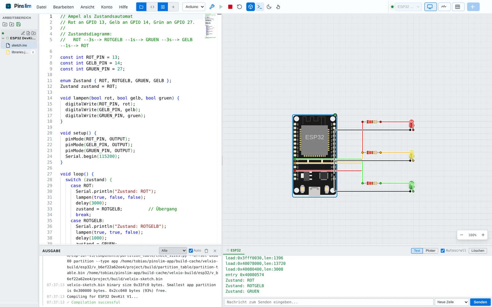
</p>

<p align="center">
  <a href="#-features">Features</a> ·
  <a href="#-boards">Boards</a> ·
  <a href="#-for-school">For school</a> ·
  <a href="#-tablets">Tablets</a> ·
  <a href="#-quick-start">Quick start</a> ·
  <a href="#-legal">Legal</a>
</p>

---

## ✨ Features

| | |
|---|---|
| **Real CPU emulation** | AVR8 (Arduino Uno / Nano / Mega / ATtiny85) and RP2040 (Raspberry Pi Pico) run in the browser; ESP32, ESP32-S3, ESP32-C3 and ESP32-C6 run on Pinslim's own QEMU build on the server. The ESP32-P4 compiles and flashes, but is not simulated. |
| **150+ parts and a circuit solver** | LEDs, buttons, potentiometers, sensors (NTC, LDR, HC-SR04, DHT22 …), displays, logic gates, resistors, capacitors, diodes, transistors — with an analog SPICE solver behind the wires. |
| **Serial monitor and plotter** | Text view, and a plotter that draws `name:value` pairs as curves (copy as CSV for the spreadsheet). |
| **Logic analyzer** | UART, I²C and SPI decoded from the pins (`S 0x3C W ✓ 0x00 ✓ P`) on Arduino, Pico and every ESP32 chip. |
| **Truth table & timing diagram** | For gate circuits: truth table, simplified Boolean expression, timing diagram, clocked timing for flip-flops. |
| **Flash to a real board** | Web Serial from Chrome / Edge: ESP32 family, Arduino Uno and Nano. Checks that the chip matches and explains errors in plain words. |
| **Touch mode for tablets** | Big controls, wiring with a finger, a symbol row above the on-screen keyboard — switchable next to light/dark. |
| **Offline and private** | No tracking, no external requests; editor, fonts, firmware and solver are served by your own server. |

<table>
  <tr>
    <td width="50%">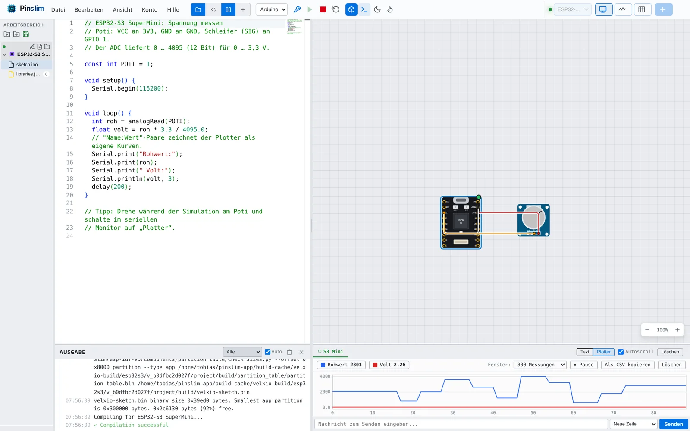<br><sub><b>Serial plotter</b> — an ESP32-S3 SuperMini measures a potentiometer; <code>Rohwert:… Volt:…</code> becomes two curves.</sub></td>
    <td width="50%">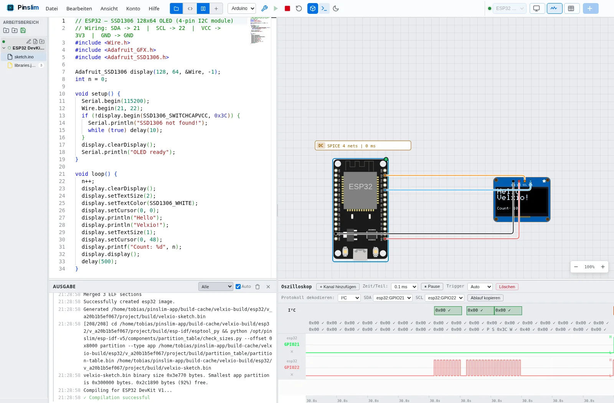<br><sub><b>Logic analyzer</b> — I²C of an ESP32 talking to an SSD1306 OLED, decoded byte by byte.</sub></td>
  </tr>
  <tr>
    <td width="50%">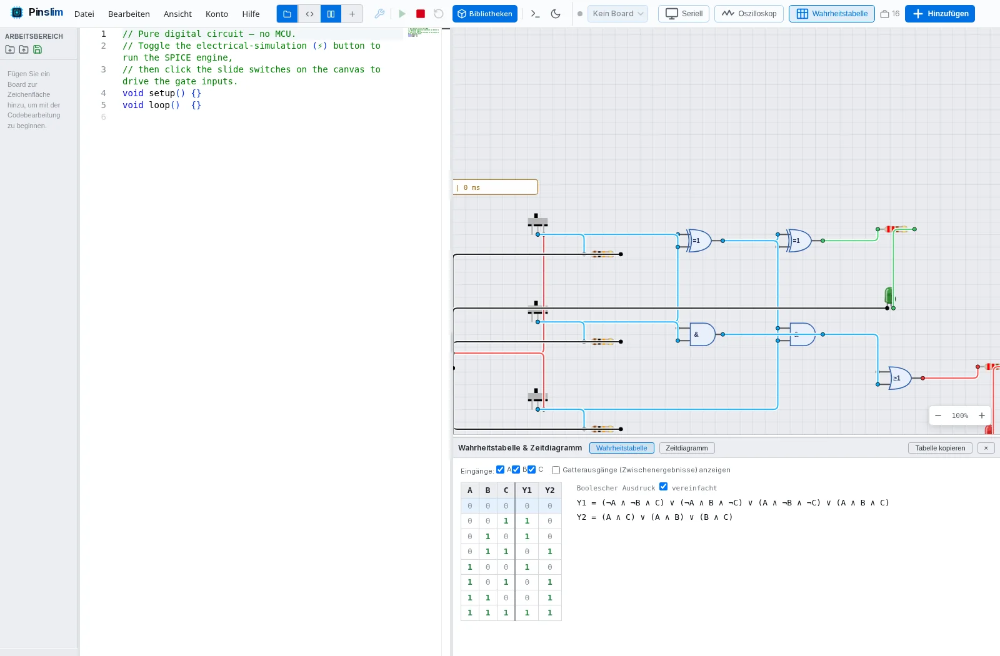<br><sub><b>Truth table</b> — a full adder, with the simplified expression for each output.</sub></td>
    <td width="50%">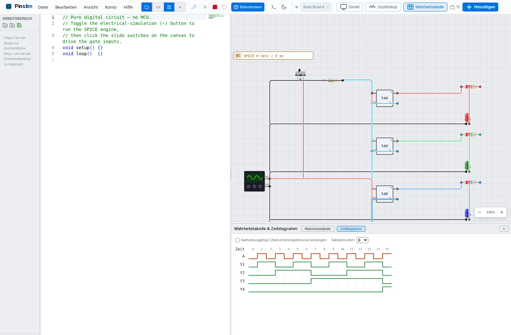<br><sub><b>Timing diagram</b> — a 4-bit ripple counter built from flip-flops.</sub></td>
  </tr>
  <tr>
    <td width="50%">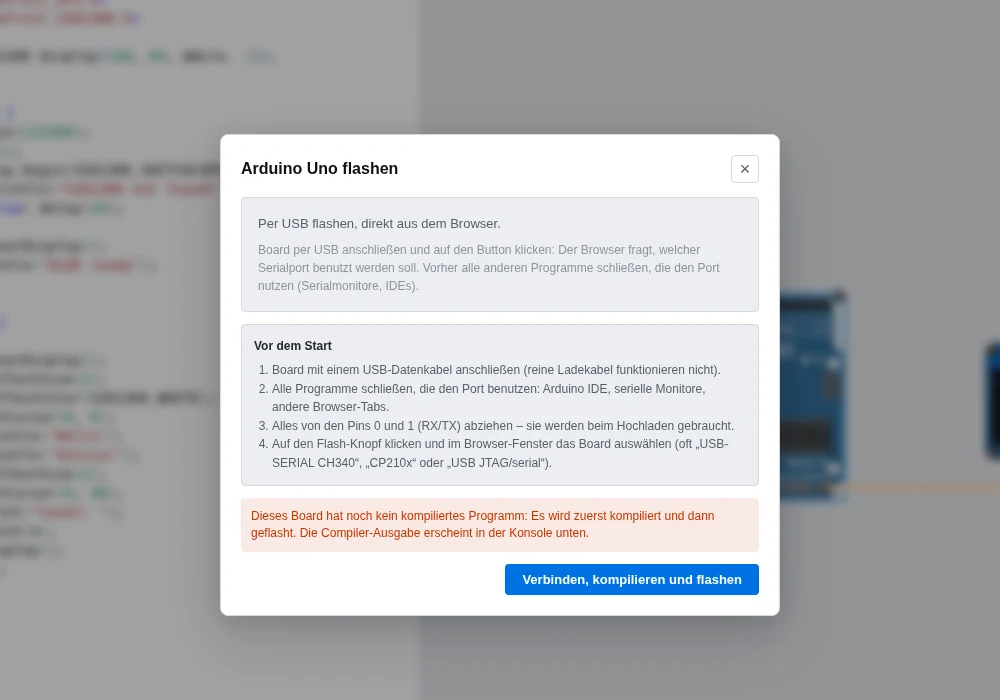<br><sub><b>Flash to a real board</b> — step-by-step over Web Serial (needs HTTPS).</sub></td>
    <td width="50%">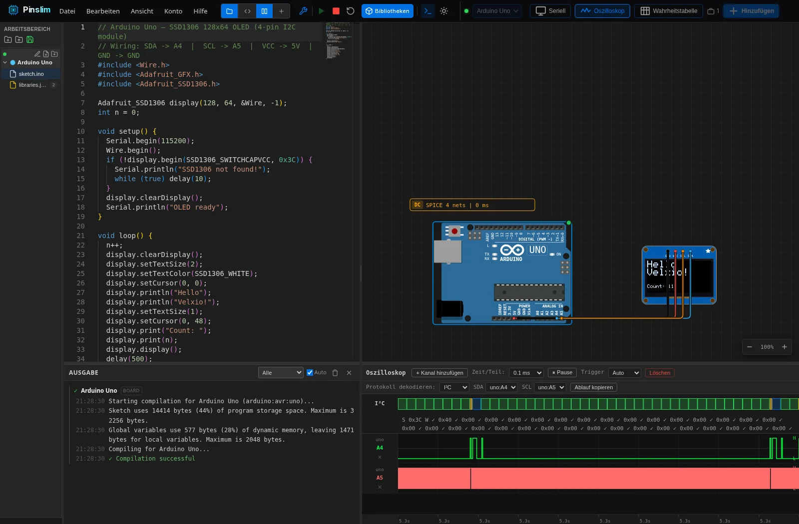<br><sub><b>Light and dark</b> — light by default for the classroom projector.</sub></td>
  </tr>
</table>

---

## 🔌 Boards

<p align="center">
  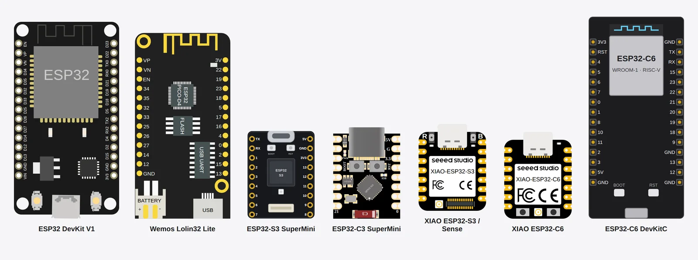
</p>

| Family | Boards | Runs in the simulator |
|---|---|---|
| **ESP32** (Xtensa) | DevKit V1, DevKit C V4, ESP32-CAM, Wemos Lolin32 Lite | ✔ (QEMU) |
| **ESP32-S3** | S3 DevKit, **S3 SuperMini**, XIAO ESP32-S3, **XIAO ESP32-S3 Sense**, Arduino Nano ESP32 | ✔ (QEMU) |
| **ESP32-C3 / C6** (RISC-V) | C3 DevKit, **C3 SuperMini**, XIAO ESP32-C3, C6 DevKitC, XIAO ESP32-C6 | ✔ (QEMU) |
| **ESP32-P4** | P4 Dev | compile + flash only |
| **AVR** | Arduino Uno, Nano, Mega 2560, ATtiny85 | ✔ (in the browser) |
| **RP2040** | Raspberry Pi Pico, Pico W | ✔ (in the browser) |

Board LEDs that a sketch can switch are drawn on the board (DevKit V1 GPIO 2, Lolin32 Lite GPIO 22, C3 SuperMini GPIO 8 — the last two light on LOW, like the real ones). WiFi is emulated on the ESP32, S3 and C3. The XIAO S3 Sense camera is not simulated.

---

## 🏫 For school

<p align="center">
  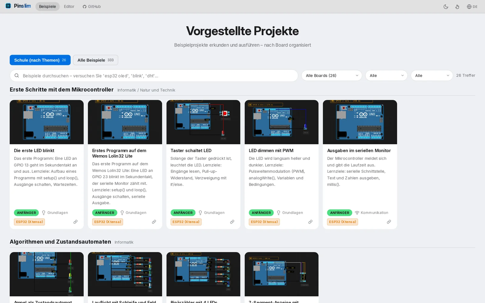
</p>

The gallery has a **school collection** sorted by topic — *first steps*, *algorithms and state machines*, *the electric circuit*, *measuring*, *semiconductors, capacitors and oscillations*, *logic gates*. Every microcontroller example runs on an **ESP32** (3.3 V logic, 12-bit ADC, GPIO numbers), with German comments and tasks for the students. Measurement sketches print semicolon-separated values with a decimal comma, so the serial output pastes straight into Excel or LibreOffice.

Extra sets for the boards common in school kits: blink, button and ADC/plotter examples for the **ESP32-C3 SuperMini**, **ESP32-S3 SuperMini** and **XIAO ESP32-S3 Sense**.

The ultrasonic example measures exactly in the simulator (30 cm → 1740 µs): with an HC-SR04 attached the ESP32 runs on instruction counting, so `pulseIn()` sees the echo in its own time.

---

## 📱 Tablets

<table>
  <tr>
    <td width="62%">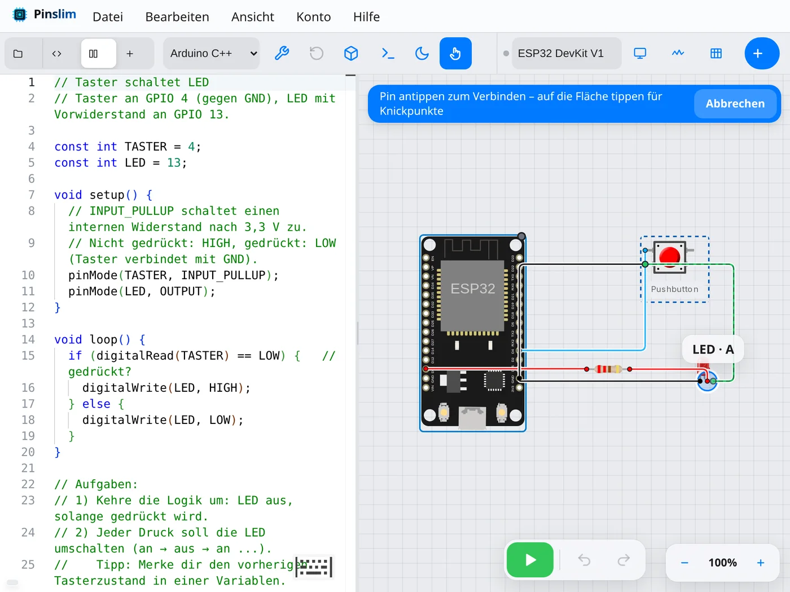</td>
    <td width="38%">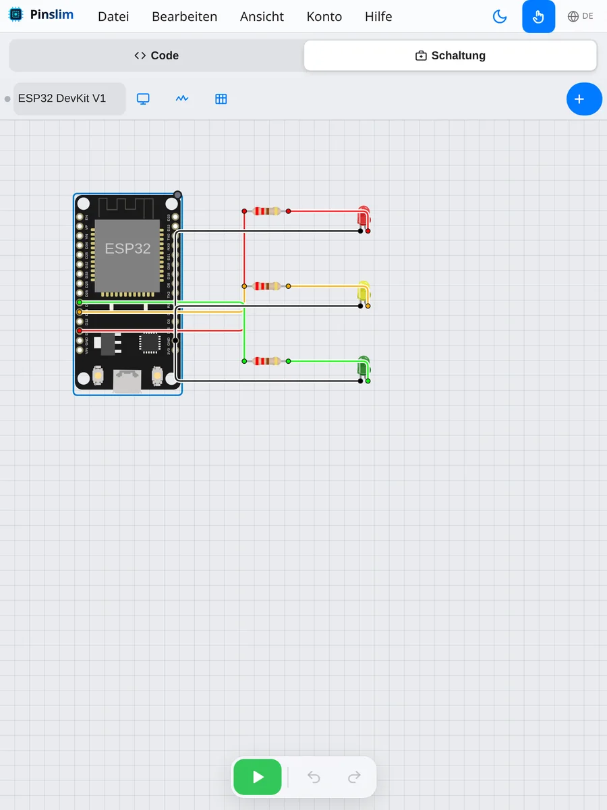</td>
  </tr>
</table>

**Touch mode** switches itself on for finger devices and can be toggled with the hand button next to light/dark. It follows Apple's interface guidelines: 44 pt targets, segmented controls, translucent floating bars.

- **Tap** a part to select it — the bar on top offers *Connect*, *Properties*, *Rotate*, *Delete*.
- **Drag a wire with a finger**: it snaps to the nearest pin within 24 px, and the pin's name is shown above the finger (which hides the pin itself).
- **Thumb bar** on the canvas: Run/Stop, Undo, Redo.
- **Symbol row** above the on-screen keyboard: `{ } ( ) [ ] ; < > = " ' /` and Tab.
- **Portrait**: Code | Circuit tabs instead of three narrow columns.

`frontend/scripts/touch-check.mjs` checks all of this in an iPad profile (`BASE_URL=http://<server>:<port> node scripts/touch-check.mjs`).

---

## 🚀 Quick start

### Docker Compose

```bash
docker compose up -d --build
```

Then open **<http://localhost:3082>**.

### Native install (without Docker)

On Debian/Ubuntu, `scripts/setup-native.sh` installs the toolchains the Docker
image bundles — arduino-cli with the AVR, RP2040 and ATtiny cores, **ESP-IDF
5.5.6 with arduino-esp32 3.3.12** (ESP32, ESP32-S3, ESP32-C3, ESP32-C6 and
ESP32-P4), and Pinslim's own QEMU build for ESP32 / ESP32-S3 / ESP32-C3 /
ESP32-C6 emulation (see [docs/BUILD-QEMU.md](docs/BUILD-QEMU.md)).

```bash
scripts/setup-native.sh          # or: arduino | espidf | qemu
```

Point the backend at the result with
`IDF_PATH=IDF5_PATH=/opt/pinslim/esp-idf-v5`, `IDF_TOOLS_PATH=/opt/pinslim/espressif`,
`ARDUINO_ESP32_PATH=ARDUINO_ESP32_5_PATH=/opt/pinslim/arduino-esp32-3`,
`QEMU_ESP32_LIB=/opt/pinslim/qemu/libqemu-xtensa.so` and
`QEMU_RISCV32_LIB=/opt/pinslim/qemu/libqemu-riscv32.so`, with `~/.local/bin`
(arduino-cli) on `PATH`.

The Docker image (`Dockerfile.standalone`) bundles the same ESP-IDF /
arduino-esp32 versions and builds Pinslim's QEMU from source unless
`prebuilt/qemu/` already holds the libraries and ROMs.

### The first ESP32 compile takes a while

The first sketch per board type builds all of ESP-IDF — on a small server
(2 cores) that is **15–40 minutes**; every sketch after that compiles in
seconds, because only the sketch is rebuilt. The backend resumes a long build
on its own for up to an hour (`ESPIDF_BUILD_BUDGET_S`). Do it before the lesson:

```bash
cd backend && python scripts/warm_builds.py \
  esp32:esp32:esp32 esp32:esp32:esp32s3 esp32:esp32:esp32c3 esp32:esp32:XIAO_ESP32S3
```

To run it after every restart, add to the backend's systemd unit (e.g. a drop-in
`/etc/systemd/system/pinslim-backend.service.d/warm-builds.conf`):

```ini
[Service]
ExecStartPost=-/bin/sh -c 'nohup /path/to/venv/bin/python /path/to/backend/scripts/warm_builds.py >> /var/log/pinslim-warm.log 2>&1 &'
```

Without arguments it warms `PINSLIM_WARM_FQBNS` (comma-separated) or the
ESP32 DevKit and the Lolin32 Lite.

### Offline and privacy (school networks)

The app itself needs no Internet and talks to no third party: the code editor,
fonts, MicroPython firmware and the circuit solver are all served from your
server, there is no tracking (the analytics tag only loads on `velxio.dev`),
and `frontend/src/__tests__/offline-first.test.ts` keeps it that way. What does need a connection:

- **Library Manager and board cores** (installing a new Arduino library or core).
- **The first compile per ESP32 chip**, which downloads ESP-IDF components once;
  after that it is cached on the server.
- **Links** such as the GitHub button, which are only requests when clicked.

A server that has once installed what the classes use keeps working with the
network cable pulled. In Docker, boot-time `arduino-cli` index updates time out
after 60 s instead of blocking the start.

### HTTPS for flashing

Browsers only offer USB access (Web Serial) on `https://` pages and on
`localhost`. On a plain `http://192.168.x.x` address the *Flash to real board*
dialog explains this instead of flashing. For a school or home server, add a
TLS listener next to the HTTP one — a self-signed certificate is enough, each
browser asks once to accept it:

```bash
sudo mkdir -p /etc/ssl/pinslim && cd /etc/ssl/pinslim
sudo openssl req -x509 -newkey rsa:2048 -nodes -sha256 -days 3650 \
  -keyout pinslim.key -out pinslim.crt -subj "/CN=pinslim.local" \
  -addext "subjectAltName=IP:<server-ip>,DNS:pinslim.local"
# in the nginx server block:
#   listen 3083 ssl;
#   ssl_certificate     /etc/ssl/pinslim/pinslim.crt;
#   ssl_certificate_key /etc/ssl/pinslim/pinslim.key;
```

Then open `https://<server>:3083`.

### Portainer & Traefik

When deploying Pinslim as a Stack in **Portainer** directly from the Git repository:

* **Repository Branch**: `master` (e.g. `https://github.com/TJRSchmidbauer/pinslim.git#master`).
* **Dockerfile Name**: `Dockerfile.standalone` under `build.dockerfile`.
* **Internal Port**: Traefik server loadbalancer port `80` (internal Nginx port).

A ready-to-use Stack template is in [`docker/portainer-stack.yml`](docker/portainer-stack.yml).

---

## 🔒 Security & server hardening

For deploying Pinslim securely on your own server (process isolation, capability dropping, CPU/RAM limits, sub-process sandboxing), see [SECURITY.md](SECURITY.md).

---

## 📜 Legal

<a name="-legal"></a>

### 1. Origin Notice & Gratitude
Pinslim is an independent open-source fork based on **Velxio**, created by **David Montero Crespo**.
- Original Repository: [github.com/davidmonterocrespo24/velxio](https://github.com/davidmonterocrespo24/velxio)
- Official Platform: [velxio.dev](https://velxio.dev)

Special thanks to **David Montero Crespo** for architecting the original simulator engine.

### 2. KI-Hinweis / AI Notice
Anpassungen, Refactorings, UI/UX-Optimierungen, Stücklisten- & PNG-Export-Erweiterungen, Web-Serial-Flasher-Integration sowie Sicherheitshärtungen an dieser Codebasis wurden in kooperativer Entwicklung unter Einsatz des KI-Assistenten **Antigravity** (Google DeepMind) umgesetzt.

Weitere Entwicklungen – unter anderem die eigene QEMU-Emulation für ESP32 / S3 / C3 / C6, Logikanalysator mit Protokoll-Dekodierung, Wahrheitstabelle und Zeitdiagramm, serieller Plotter, die Schul-Beispiele auf dem ESP32, die Touch-Bedienung für Tablets sowie die Boards ESP32-S3 SuperMini und XIAO ESP32-S3 Sense – entstanden in kooperativer Entwicklung mit dem KI-Assistenten **Claude** (Anthropic, über Claude Code). Die jeweiligen Commits sind mit `Co-Authored-By: Claude …` gekennzeichnet.

### 3. Trademark Disclaimer
All product names, trademarks, logos, and brands mentioned in this project (such as *Arduino, ESP32, Espressif, Raspberry Pi, MicroPython, SAMD, RP2040, Seeed Studio XIAO, Apple, iPad, etc.*) are the property of their respective trademark owners. Pinslim is an independent open-source community project and is **not affiliated with, sponsored by, or endorsed by** any of these trademark holders. The touch mode follows Apple's published interface guidelines as a design reference; it uses no Apple assets or fonts.

### 4. Commercial Licensing & Partner Disclaimer
- Commercial licenses or Pro subscriptions are sold exclusively by David Montero Crespo via [velxio.dev](https://velxio.dev). Pinslim does not sell commercial licenses or process payments.
- Any partners, sponsors, or commercial hardware suppliers referenced in connection with the original Velxio project belong solely to Velxio and David Montero Crespo. They are **not partners or sponsors of Pinslim**.

### 5. License & Warranty Disclaimer (Lizenz & Haftungsausschluss)
Pinslim is licensed under the **GNU Affero General Public License v3.0 (AGPLv3)**. The software is provided "AS IS", without warranty of any kind, express or implied.

### 6. Quellen & Referenzen / Sources & References
- [Velxio](https://github.com/davidmonterocrespo24/velxio) - Original-Basis-Projekt von David Montero Crespo
- [Wokwi](https://wokwi.com) - Inspirationsquelle & Elektronik-Simulator-Plattform
- [wokwi-elements](https://github.com/wokwi/wokwi-elements) - Open-Source Web-Komponenten für elektronische Bauteile
- [avr8js](https://github.com/wokwi/avr8js) - In-Browser AVR8 Microcontroller Emulations-Engine
- [rp2040js](https://github.com/wokwi/rp2040js) - In-Browser RP2040 Microcontroller Emulations-Engine
- [arduino-cli](https://github.com/arduino/arduino-cli) - Command-Line Interface für Arduino Sketches
- [Monaco Editor](https://microsoft.github.io/monaco-editor/) - Code-Editor Engine (VS Code in-browser)
- [ESP-IDF](https://github.com/espressif/esp-idf) - Espressif IoT Development Framework für ESP32/RISC-V
- [QEMU](https://www.qemu.org/) - Open-Source Machine Emulator (ESP32 & Raspberry Pi System-Simulation)
- [Lucide](https://lucide.dev) - Icons (ISC licence)
- [Fritzing](https://fritzing.org) - Open-Source Hardware Initiative & Vektorgrafiken für elektronische Bauteile
- [espboards.dev](https://espboards.dev/esp32/esp32-s3-super-mini/) - Pinbelegung des ESP32-S3 SuperMini
