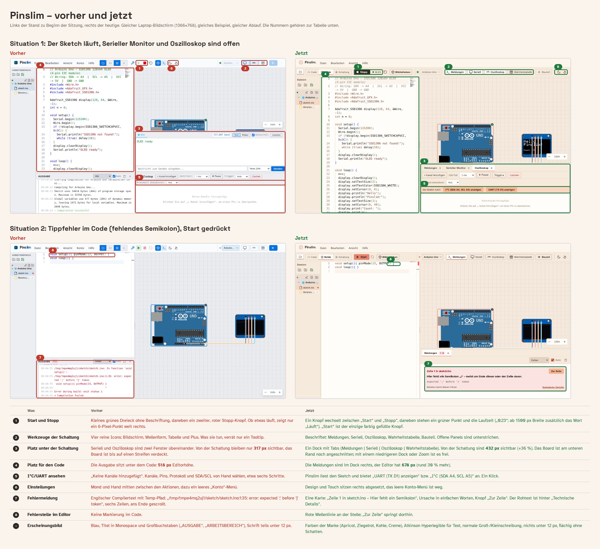

# Pinslim: vorher und jetzt

Dieses Dokument zeigt, was sich an der Bedienung von Pinslim geändert hat, und begründet es. Die Bilder und Zahlen stammen aus einem echten Vergleich: derselbe Laptop-Bildschirm, dasselbe Beispiel, derselbe Ablauf, links der alte Stand, rechts der neue.

## So wurde verglichen

| | |
|---|---|
| Alter Stand | Commit [`4815647`](https://github.com/TJRSchmidbauer/pinslim/commit/4815647f) (Beginn der Überarbeitung) |
| Neuer Stand | Commit `aaf3fd6` (`master`) |
| Bildschirm | 1366 × 768, Chromium, helles Design |
| Beispiel | „Arduino Uno: SSD1306 OLED (4-Pin I²C)“, echtes Kompilieren und Laufen im Simulator |
| Situation 1 | Sketch starten, Serielle Monitor und Oszilloskop öffnen |
| Situation 2 | Im Code ein Semikolon streichen und „Start“ drücken |

Alle Zahlen (Pixelhöhen, Anzahl Schritte) sind in genau diesen zwei Situationen auf diesem Bildschirm gemessen. Auf anderen Größen weichen sie ab.

## Was besser ist

### 1. Start und Stopp sind ein Knopf, der Zustand steht daneben
**Vorher:** Ein kleines grünes Dreieck ohne Beschriftung und daneben ein zweiter, roter Stopp-Knopf. Ob etwas läuft, zeigte nur ein 6-Pixel-Punkt weit rechts.
**Jetzt:** Ein Knopf wechselt zwischen „Start“, „Kompiliere …“ und „Stopp“. Daneben stehen ein grüner Punkt und die Laufzeit. Ab 1500 px Breite steht zusätzlich „Läuft“. „Start“ ist der einzige farbig gefüllte Knopf. Schaltungen ohne Board zeigen „Pause“ und „Weiter“.
**Warum:** Der Systemzustand soll sichtbar sein ([Nielsen](https://ixdf.org/literature/article/user-interface-design-guidelines-10-rules-of-thumb)). Apple und SAP empfehlen genau eine hervorgehobene Hauptaktion pro Ansicht ([Apple HIG](https://developer.apple.com/design/human-interface-guidelines/toolbars), [SAP Fiori](https://www.sap.com/design-system/fiori-design-web/v1-139/ui-elements/header-toolbar/usage)).

### 2. Beschriftete Werkzeuge
**Vorher:** Vier reine Icons (Bildschirm, Wellenform, Tabelle, Plus). Was sie tun, verriet nur ein Tooltip.
**Jetzt:** „Meldungen“, „Seriell“, „Oszilloskop“, „Wahrheitstabelle“, „Bauteil“. Offene Panels sind unterstrichen, auf allen Breiten ab 1366 px. Darunter fallen sie auf Icons mit Tooltip zurück.
**Warum:** Eine Beschriftung ist für Schüler schneller zu erfassen als ein Symbol ([KDE HIG](https://develop.kde.org/hig/components/navigation/toolbar)). Reine Icon-Knöpfe brauchen mindestens Tooltip und Zugriffsnamen ([Microsoft](https://microsoft.github.io/coreai-design-system/components/Toolbar/)).

### 3. Ein Dock mit Tabs statt gestapelter Fenster
**Vorher:** Serieller Monitor und Oszilloskop lagen als zwei Fenster übereinander, die Ausgabe zusätzlich unter dem Code. Von der Schaltung blieben **317 px** sichtbar, das Board war bis auf einen Streifen verdeckt.
**Jetzt:** Ein Dock unter der Schaltung mit den Tabs „Meldungen | Seriell | Oszilloskop | Wahrheitstabelle“. Von der Schaltung sind **432 px** sichtbar (+36 %). Das Board ist bei dieser Dock-Höhe am unteren Rand noch angeschnitten, mit einem niedrigeren Dock oder Zoom ist es frei.

### 4. Der Editor hat mehr Platz
**Vorher:** Die Ausgabe sitzt unter dem Code, **518 px** Editorhöhe.
**Jetzt:** Die Meldungen sind im Dock rechts, der Editor hat **678 px** (rund 30 % mehr). In der reinen Code-Ansicht (und im Code-Tab auf dem Handy) liegt das Dock unter dem Editor, damit Fehler nie hinter einer eingeklappten Schaltung verschwinden.

### 5. I²C, SPI und UART mit einem Klick ansehen
**Vorher:** „Keine Kanäle hinzugefügt“. Kanäle, Pins, Protokoll und SDA/SCL von Hand wählen, etwa sechs Schritte.
**Jetzt:** Pinslim liest den Sketch (`Wire.begin()`, `SPI.begin()`, `Serial.begin()`), kennt die Standardpins des Boards und bietet an: „I²C (SDA A4, SCL A5) anzeigen“. Ein Klick legt die Kanäle an und startet die Dekodierung. Das funktioniert für Uno/Nano, Mega, Pico (auch mit `Wire.setSDA/SCL`) und ESP32 (mit Standardpins oder `Wire.begin(sda, scl)`).

### 6. Einstellungen sind keine Aktionen
**Vorher:** Mond (Design) und Hand (Touch) standen mitten zwischen den Aktionen, dazu ein leeres „Konto“-Menü.
**Jetzt:** Design und Touch sitzen rechts abgesetzt, das leere Menü ist weg. Der Dateien-Knopf steht für sich, die drei Ansichten sind ein Umschalter.

### 7. Fehler, die ein Schüler lesen kann
**Vorher:** Englischer Compilertext mit Temp-Pfad: `/tmp/tmpe4mq2uj1/sketch/sketch.ino:1:35: error: expected ';' before '}' token`, sechs Zeilen, ans Ende gescrollt.
**Jetzt:** Eine Karte: „Zeile 1 in sketch.ino – Hier fehlt ein Semikolon „;“ – meist am Ende dieser oder der Zeile davor.“ Dazu ein Knopf „Zur Zeile“. Der Rohtext ist hinter „Technische Details“, ohne Temp-Pfade. Erkannt werden unter anderem fehlendes Semikolon, fehlende Klammern, unbekannte Namen und Typen, fehlende Bibliotheken („Installiere sie über Bibliotheken“) und ungültige Zeichen.

### 8. Die Fehlerstelle ist im Code markiert
**Vorher:** Keine Markierung im Editor.
**Jetzt:** Rote Wellenlinie an der Stelle, „Zur Zeile“ springt dorthin (auch in eine andere Datei). Die Markierung verschwindet beim ersten Bearbeiten.

### Erscheinungsbild
- **Farben:** Die Palette von [schmidbauer.io](https://schmidbauer.io/): Apricot, Ziegelrot, Kohle, Creme, flächig ohne Verläufe und Schatten.
- **Schrift:** Atkinson Hyperlegible für Text, Space Grotesk für Überschriften, Monospace nur für Code und Messwerte.
- **Typografie:** Keine Versalien-Labels in der Editor-Oberfläche, nichts unter 12 px.

## Weitere Verbesserungen, die im Bild nicht zu sehen sind

- **Zielgrößen:** Alles in der Editor-Oberfläche ist mindestens 24 px groß (WCAG 2.2, [2.5.8](https://www.w3.org/WAI/WCAG22/Understanding/target-size-minimum.html)), die meisten Knöpfe 28 px. Im Touch-Modus sind es 44 px. Deaktivierte Knöpfe sagen, warum („Beim Lauf nicht möglich – erst Stopp drücken“).
- **Startdialog:** Drei empfohlene Boards (Arduino Uno, ESP32 DevKit V1, Raspberry Pi Pico), der Rest hinter „Alle Boards anzeigen“.
- **Galerie:** Alle 342 Vorschaubilder neu aufgenommen im hellen Markenschema.
- **Upstream:** 34 Fehlerkorrekturen aus [Velxio](https://github.com/davidmonterocrespo24/velxio) übernommen (Draht-Routing, AVR-Takt und PWM, SPICE, Datenblätter). Weitere rund 116 kollidieren mit Pinslims Umbau und sind nicht übernommen.
- **Beispiele:** Auf den Displays der Beispielsketche steht „Pinslim“ statt „Velxio“.
- **Tests:** 17 neue Unit-Tests für Busserkennung und Fehlertexte, die Gesamtsuite läuft grün.

## Grenzen

- **Nicht mit Schülern getestet.** Das ist eine Bewertung nach Gestaltungsregeln und nach Messungen, kein Nutzertest. Ob die Bedienung wirklich schneller verstanden wird, zeigt erst ein Test mit Schülern.
- **Messwerte:** Gelten für 1366 × 768. Bei 1280 px Breite fällt die Leiste im Lauf auf Icons mit Tooltips zurück, bei 1024 px (Tablet quer) ebenfalls.
- **ESP32-Simulation:** Die ESP32-Simulation (QEMU) lief in der Umgebung, in der diese Bilder entstanden, nicht. Deshalb zeigen README und Landingpage bei Plotter und Logikanalysator einen Arduino Uno statt eines ESP32, und `docs/img/site/c6.webp` ist noch im alten Blau.
- **Nicht umgesetzt:** Die Dateileiste klappt nicht automatisch ein, wenn nur eine Datei offen ist, weil sie „Neu / Öffnen / Speichern“ enthält.

## Quellen

- [W3C: Understanding Target Size (Minimum) 2.5.8](https://www.w3.org/WAI/WCAG22/Understanding/target-size-minimum.html)
- [TetraLogical: Foundations, target sizes](https://tetralogical.com/blog/2022/12/20/foundations-target-size/)
- [SAP Fiori: Header Toolbar](https://www.sap.com/design-system/fiori-design-web/v1-139/ui-elements/header-toolbar/usage)
- [Apple HIG: Toolbars](https://developer.apple.com/design/human-interface-guidelines/toolbars)
- [Microsoft Core AI Design System: Toolbar](https://microsoft.github.io/coreai-design-system/components/Toolbar/)
- [KDE HIG: Toolbar](https://develop.kde.org/hig/components/navigation/toolbar)
- [PhET: A Study of Educational Simulations, Part II – Interface Design](https://phet.colorado.edu/publications/archive/PhET%20Interview%20Paper%20Part%20II.htm)
- [IxDF: User Interface Design Guidelines, 10 rules of thumb (Nielsen)](https://ixdf.org/literature/article/user-interface-design-guidelines-10-rules-of-thumb)

Mehrere dieser Quellen sind Zweitzusammenfassungen und keine Primärdokumente; die Zahlen für Touch-Größen (44 pt, 48 dp) stammen aus solchen Zusammenfassungen.
